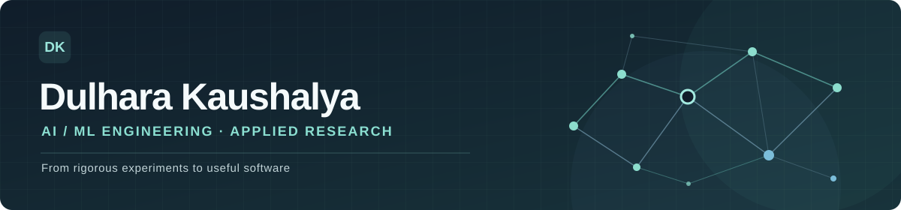

  

  <strong>AI/ML Engineer · Applied AI Research · Data Science</strong>

  <a href="https://dulharakaushalya.vercel.app/">Portfolio</a>
  &nbsp;·&nbsp;
  <a href="https://www.linkedin.com/in/dulhara-kaushalya/">LinkedIn</a>
  &nbsp;·&nbsp;
  <a href="https://huggingface.co/dulharakaushalya">Hugging Face</a>
  &nbsp;·&nbsp;
  <a href="https://medium.com/@nwatch117">Writing</a>
  &nbsp;·&nbsp;
  <a href="mailto:dulhara.kaushalya79@gmail.com">Email</a>

---

### About

I'm a Data Science undergraduate at the **Sri Lanka Institute of Information Technology (SLIIT)**, building machine-learning systems that connect careful experimentation with usable applications.

My interests are in **applied machine learning, natural language processing, speech technology, and reliable AI systems**. I enjoy working across the process: preparing data, developing and evaluating models, building APIs, and integrating them into software people can use.

I previously worked as an **AI/ML Engineer Intern at Sri Lanka Telecom (SLT) Digital Lab R&D**, contributing to AI-enabled applications and speech-processing projects.

### Selected work

| Project | What I worked on |
| :--- | :--- |
| **[TC-WPN · Clinical NLP](https://github.com/dulhara79/tcwpn_test)** | Research into few-shot clinical-text modelling using Bio_ClinicalBERT representations and prototypical learning, with an emphasis on patient-disjoint evaluation and leakage controls. |
| **[VoxLive · Live Transcription](https://github.com/dulhara79/voxlive_transcription)** | A real-time speech transcription application with speaker-aware transcript presentation. |
| **[ClinAnx · Clinician Mobile App](https://github.com/dulhara79/tcwpn_mobile_app)** | A Flutter research prototype that presents assessment data, supporting evidence, and uncertainty-aware clinician workflows. |
| **[AI Thread Exporter](https://github.com/dulhara79/chatgpt-thread-exporter)** | A browser extension for locally exporting ChatGPT and Claude conversations to structured PDF, Word, and Markdown files. |

My clinical NLP work is part of **[R26-DS-012](https://github.com/dulhara79/R26-DS-012)**, a collaborative multimodal anxiety research project. This is academic research and decision-support prototyping, **not a diagnostic device**.

### Technical toolkit

| Area | Technologies |
| :--- | :--- |
| **Machine learning & NLP** | Python · PyTorch · Hugging Face Transformers · scikit-learn · NumPy · Pandas |
| **Applications & APIs** | FastAPI · React · Flutter · REST APIs |
| **Development & delivery** | Git · GitHub · Docker · Linux |

I prefer showing what I've built over listing every tool I've encountered. The linked repositories and [portfolio](https://dulharakaushalya.vercel.app/) provide more context.

### Experience & education

- **AI/ML Engineer Intern · SLT Digital Lab R&D** — 2026. Applied AI/ML development and speech-related engineering work.
- **B.Sc. (Hons) in Information Technology, specialising in Data Science · SLIIT** — Undergraduate.

### Connect

I'm interested in **AI/ML engineering opportunities** and thoughtful research or software collaborations.

**[Portfolio](https://dulharakaushalya.vercel.app/)** · **[LinkedIn](https://www.linkedin.com/in/dulhara-kaushalya/)** · **[Email](mailto:dulhara.kaushalya79@gmail.com)**
